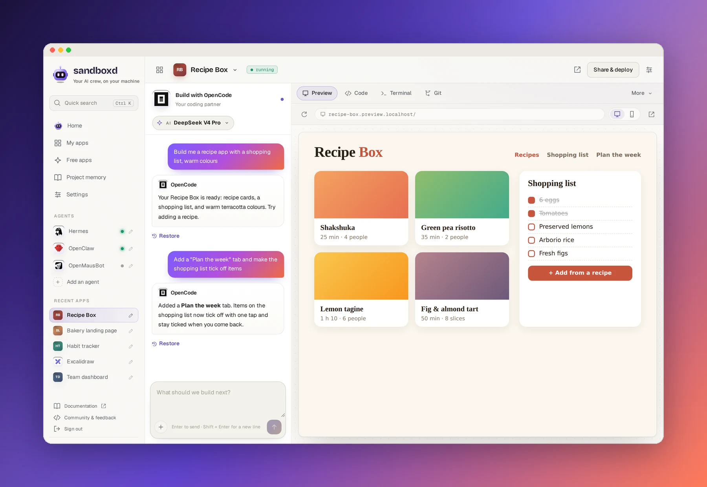
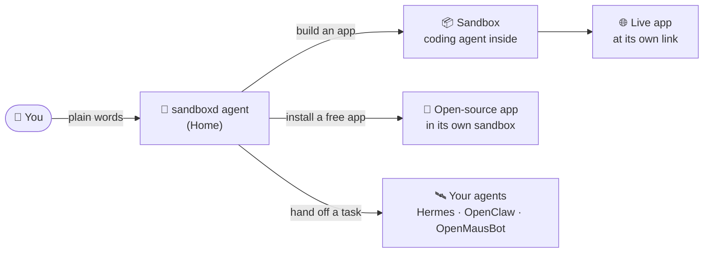
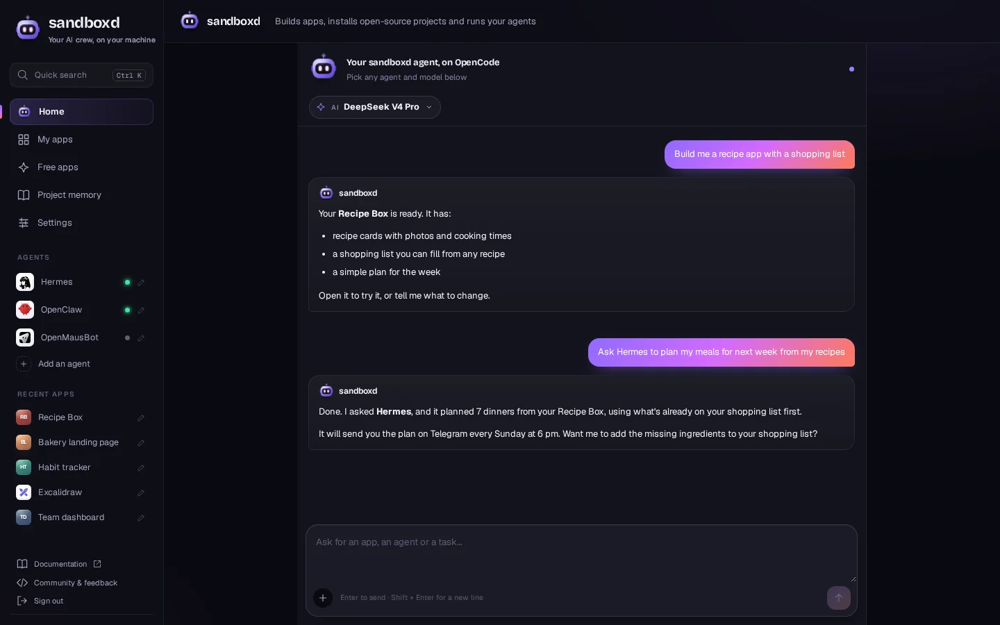
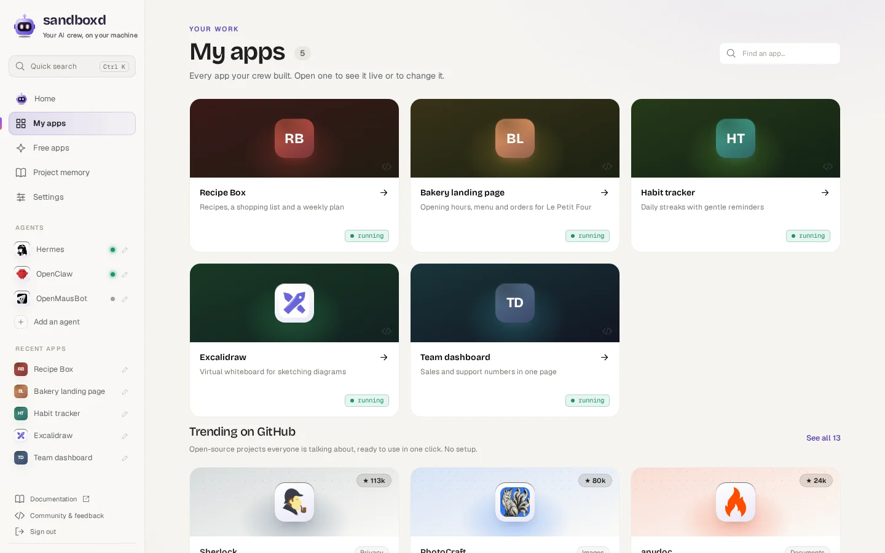
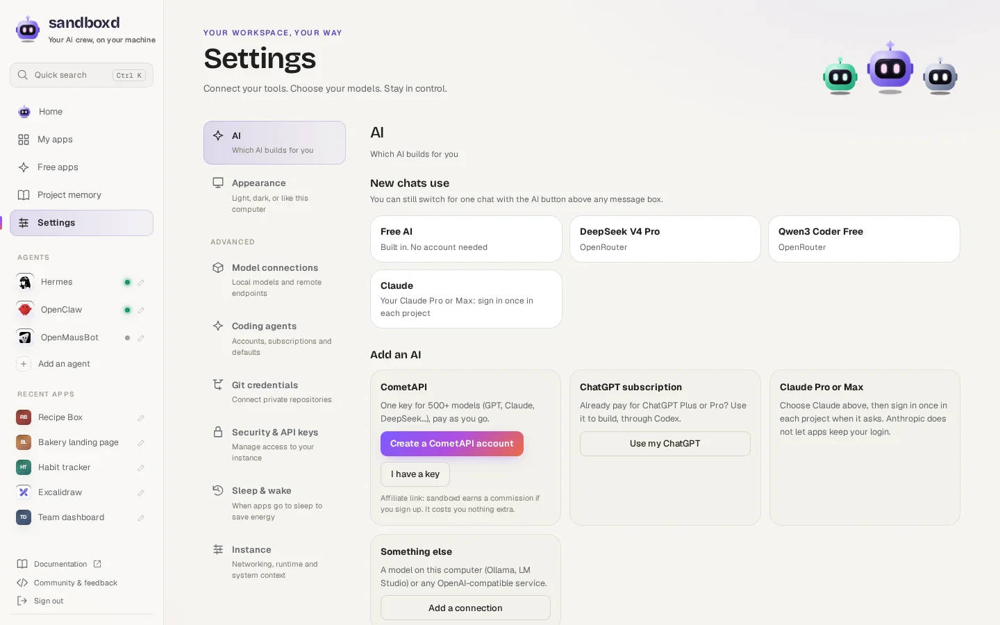

<h1 align="center">sandboxd</h1>

<p align="center">
  <b>Your AI crew, on your own machine.</b><br/>
  Ask in plain words. sandboxd builds the apps you need, installs free open-source
  ones in one click, and runs agents that keep working for you, all on
  <b>your</b> computer or server. Open-source, self-hosted, MIT.
</p>

<h3 align="center">🔥 Trend of the Day on Trendshift</h3>

<p align="center">
  <a href="https://trendshift.io/repositories/45741?utm_source=trendshift-badge&utm_medium=badge&utm_campaign=badge-trendshift-45741" target="_blank" rel="noopener noreferrer">
    
  </a>
</p>

<p align="center">
  <a href="https://sandboxd.io/demo/"></a>
  &nbsp;
  <a href="https://sandboxd.io/quickstart"></a>
  &nbsp;
  <a href="https://github.com/tastyeffectco/sandboxd/stargazers"></a>
</p>

<p align="center">
  <a href="https://sandboxd.io"></a>
  <a href="LICENSE"></a>
  
  <a href="https://github.com/tastyeffectco/sandboxd/releases"></a>
  <a href="https://github.com/sponsors/tastyeffectco"></a>
</p>


<p align="center">
  
</p>

<p align="center"><sub>One sentence in, a working app out: the chat that built <b>Recipe Box</b> on the left, the live app on the right.</sub></p>

---

## What is sandboxd?

sandboxd is like having a small team of AI helpers that live on your computer.

- **You talk to one assistant, the sandboxd agent.** It is the first thing you
  see. Tell it what you want in your own words.
- **It builds apps.** *"Build me a recipe app with a shopping list"* gives you a
  real, running app at its own link, in a few minutes. Keep chatting to change it.
- **It installs free apps.** Excalidraw, draw.io, Uptime Kuma and dozens more
  open-source apps, in one click, with no account and no AI needed to use them.
- **It runs agents for you.** Hermes, OpenClaw and OpenMausBot are open-source
  assistants that remember you, run scheduled jobs, browse the web and can reach
  you on Telegram. Ask sandboxd to hand them work and it brings the answers back.

Everything runs on **your** machine: your apps, your code, your data. It starts
free with OpenCode's built-in AI (no account, no credit card), and you can plug
in your own subscription or models whenever you want.

Under the hood each app lives in its own **isolated sandbox** (a locked-down
container with its own files and limits). A coding agent works inside it, the app
is served at a live preview link, and idle apps **go to sleep and wake on
demand**, so one ordinary computer holds many of them. It is one Go program
driving Docker, with Traefik for links and SQLite for state: no Kubernetes, no
separate database, no queue.



## A quick tour

<table>
  <tr>
    <td width="50%" valign="top"><br><sub><b>Home.</b> One chat with the sandboxd agent: ask for an app, a free app, an agent or a task.</sub></td>
    <td width="50%" valign="top"><br><sub><b>My apps.</b> Everything your crew built, plus what's trending on GitHub, ready in one click.</sub></td>
  </tr>
  <tr>
    <td width="50%" valign="top"><br><sub><b>Free apps.</b> Popular open-source apps, each pinned to a tested release and run in its own sandbox.</sub></td>
    <td width="50%" valign="top"><br><sub><b>Agents.</b> Add Hermes, OpenClaw or OpenMausBot, or several of each, each with its own memory.</sub></td>
  </tr>
  <tr>
    <td width="50%" valign="top"><br><sub><b>Talk to an agent.</b> Hermes watches flight prices every morning and pings you on Telegram.</sub></td>
    <td width="50%" valign="top"><br><sub><b>Choose your AI.</b> Free to start; add OpenRouter, CometAPI, your ChatGPT or Claude subscription, or a model on your own computer.</sub></td>
  </tr>
  <tr>
    <td colspan="2" align="center"><br><b>▶ <a href="https://sandboxd.io/demo/">Try the live demo</a></b><br><sub>Click around a real console with sample data, no install.</sub><br><br></td>
  </tr>
</table>

Dark or light: **Settings → Appearance** follows your computer, or pick one.

## What your crew can do

- **✨ Build apps from a sentence.** *"A habit tracker"*, *"a landing page for my
  bakery"*, *"a team dashboard"*. A coding agent (OpenCode, Claude Code, Codex or
  Pi) builds it in its own sandbox while you watch the live preview. Keep
  chatting to change it; every step is a checkpoint you can restore. Attach your
  logo or photos with **+**, by dropping them, or by pasting.
- **🧩 Install free apps in one click.** A CAD modeler, a physics simulator
  (MuJoCo), a username finder (Sherlock), whiteboards, PDF and slide tools, and
  more. A **Trending** strip shows what's hot on GitHub.
  [Free apps →](docs/free-apps.md)
- **🤖 Run agents that work around the clock.**
  [Hermes](https://github.com/NousResearch/hermes-agent), OpenClaw and
  OpenMausBot remember you, run scheduled jobs, browse, reach you on Telegram,
  and can create and change apps. Each runs in its own locked-down container, with
  no keys inside. Only open-source agents that run fully on your machine are
  offered. [Agents →](docs/operator-agents.md)
- **💬 One assistant for all of it.** The sandboxd agent checks a project can run
  before installing it, hands tasks to your agents and brings their answers back,
  and deletes nothing without your yes.
  [The sandboxd agent →](docs/sandboxd-agent.md)
- **🧠 Your AI, your choice.** OpenCode's free AI needs no account. In
  **Settings → AI** pick what every new chat uses, and add more in a few clicks:
  OpenRouter sign-in, a CometAPI key, your ChatGPT or Claude subscription, a
  local model server (Ollama, LM Studio) or any OpenAI- or Anthropic-compatible
  endpoint, including LiteLLM gateways routing to AWS Bedrock. The **AI** button
  above any message box switches for one chat. Keys stay encrypted on the
  control plane and never enter a sandbox.
  [Model connections →](docs/model-providers.md)
- **🚀 Keep what you build.** Review the code, commit and push it to your own Git
  repository, or self-host it on your own server.

> **Dev → prod, never shorter:** prompt an app into a sandbox, iterate on a live
> preview, then self-host it on your own server in [one command](#-deploy-to-a-vps-in-one-click).

## Get started

### On Windows or macOS: the desktop app

The desktop app is the easiest way in. On Windows it installs its own engine with
one click on **Install & start**: no Docker Desktop, no terminal, no account, and
keeps it updated. [Desktop app, downloads and release status →](docs/desktop.md)

### On a Linux server or your own machine: one command

Needs **Docker + the Compose plugin** and **git** (macOS via Docker Desktop is
best-effort). Runs natively on **amd64 and arm64**, including Apple Silicon and
arm64 Linux hosts such as AWS Graviton.

```bash
curl -fsSL https://raw.githubusercontent.com/tastyeffectco/sandboxd/main/install.sh | bash
```

It starts the engine **with the web console** and prints your **console URL**.
Create your password on first visit, then tell sandboxd on **Home** what you
want. That's it.

- **Console:** `http://console.localhost`. Run **`./console-login.sh`** to show
  the URL or reset the password.
- **API:** `http://127.0.0.1:9090` (`curl http://127.0.0.1:9090/healthz` → `ok`)
- **Verified images:** on a clean stable release checkout with `cosign`
  installed, the installer pulls the prebuilt multi-arch images and verifies each
  one is **cosign-signed with build provenance** by
  [the release workflow](.github/workflows/release-images.yml) at the exact
  release tag. `./install.sh --pull` requires those checks; a failure in
  automatic mode falls back to building from source.
- **Build from source:** **`./install.sh --build`** compiles every image locally,
  so you audit exactly what runs. A first-class, fully supported path.
- **Desktop app from the CLI:** installed by default on macOS; opt out with
  `--no-desktop` / `-NoDesktop` or `SANDBOXD_DESKTOP=0`. `install.ps1` remains for
  existing Docker Desktop/WSL setups on Windows.
- **Headless:** `--no-console --no-desktop` (Windows: `-NoConsole -NoDesktop`).
- **Upgrade later:** **`./upgrade.sh`** backs up your database, health-checks the
  new version and rolls back automatically if it fails
  ([Upgrading](docs/upgrading.md)). `./upgrade.sh --check` shows your version.

### Building a product? Drive the API

Everything the console does is a `/v1` call, so you can build sandboxd into your
own product. The console is a pure `/v1` client; the engine runs perfectly
headless without it. Connect an agent once, create a sandbox, hand it a prompt:

```bash
API=http://127.0.0.1:9090
curl -s -XPOST $API/v1/agents/claude-code/api-key -d '{"api_key":"sk-ant-..."}'
ID=$(curl -s -XPOST $API/sandbox -d '{"ports":[3000]}' | sed -E 's/.*"id":"([^"]+)".*/\1/')
curl -s -XPOST $API/v1/sandboxes/$ID/tasks -d '{"prompt":"build a todo app on port 3000","agent":"opencode"}'
# open the result at  http://s-$ID-3000.preview.localhost
```

**Full walkthrough → [sandboxd.io/quickstart](https://sandboxd.io/quickstart)** ·
**[Console guide](console/README.md)** · **[`AGENTS.md`](AGENTS.md)** for driving
it from your own agent.

## 🚀 Deploy to a VPS in one click

sandboxd needs one Linux server with Docker — nothing else. Grab a server
below (2 vCPU / 4 GB is plenty to start), paste our
[cloud-init file](deploy/cloud-init.yaml) at creation, and it installs itself.

> **Disclosure:** we earn a referral commission when you sign up through the
> provider links below, at no additional cost to you. It helps fund sandboxd's
> development.

[](https://www.vultr.com/?ref=9912150)

<!-- ENABLE THESE AS EACH AFFILIATE LINK ARRIVES (uncomment + replace placeholder):
[](YOUR_DO_AWIN_LINK)
[](YOUR_KAMATERA_AFF_LINK)
[](YOUR_HOSTINGER_AFF_LINK)
Linode removed — cash affiliate program discontinued (credits only as of Jul 2026).
-->

Then on the new server (or paste [`deploy/cloud-init.yaml`](deploy/cloud-init.yaml) as user-data and skip this):

```bash
curl -fsSL https://raw.githubusercontent.com/tastyeffectco/sandboxd/main/deploy/bootstrap.sh | sudo bash
```

Full per-provider walkthrough: [deploy/DEPLOY.md](deploy/DEPLOY.md).

## Who's it for?

- **🙋 Anyone who wants apps and helpers without code.** Describe it, use it,
  keep it, on your own machine and with your own data.
- **🛠️ Builders of AI products.** An AI app-builder, an agent platform, a coding
  playground, per-user or per-branch preview environments, or team multi-app
  hosting: sandboxd runs **many sandboxes for other people** behind one API.

Just need one or two containers for yourself, with no AI? A shell script or
`docker run` is simpler. ([Why not just a script?](https://sandboxd.io/what-is-sandboxd))

## Under the hood

- **Isolated sandboxes:** a hardened container per app with a workspace and a live
  preview URL; sleep/wake so idle apps cost nothing.
- **Built-in coding agents:** OpenCode, Claude Code, Codex and Pi. **No credential
  ever enters a sandbox** (a proxy injects it on the wire), and every task is
  **checkpointed and revertible**.
- **Free apps, agents and the sandboxd agent:** one-click open-source projects,
  always-on assistants with their own memory, and one assistant that drives them
  all, through the same `/v1` API.
- **Desktop app:** the same console as a native Windows/macOS app; on Windows it
  provisions and updates its own engine.
- **Runtime presets:** React/Vite, Next.js, Node/Express, FastAPI, Worker; boot to a
  preview and reload after agent edits.
  [Base image, stacks &amp; presets →](https://sandboxd.io/guides/images-stacks-presets)
- **Files, Git and secrets:** in-browser editor and diffs, commit and push, per-app
  config/secrets (encrypted, write-only).
- **Snapshots, fork and restore,** an activity timeline, per-process logs and live
  lifecycle tuning. [Architecture →](https://sandboxd.io/reference/architecture)

## Get a public URL — sandboxd Cloud

Out of the box, previews live on `<ip>.sslip.io` or `localhost`: fine on your
network, useless for sharing. **[sandboxd Cloud](https://sandboxd.io/cloud)**
gives the server you already run `https://you.sandboxd.io` (console, API and
`*.preview.you.sandboxd.io`) in one command — no domain, DNS, open ports or
certificates, and it works behind NAT, on a laptop, or on a $5 VPS. Your
compute and data stay on your machine. $9.99/server/month, 50% off at launch.
Prefer your own domain? [Production / TLS](https://sandboxd.io/guides/production-tls).

## Managed — we run it for you

Don't want to run the server yourself? We'll **install, configure, and manage
sandboxd on your own box** — BYOC (your compute, your data, no lock-in). One-time
setup + optional monthly management. **[See Managed →](https://sandboxd.io/managed)**

---

<h3 align="center">📣 Stay in the loop</h3>

<p align="center">
  Self-hosting is <b>MIT and free, forever</b> — <code>git clone</code> and you're done.<br/>
  Want the <b>1.0 release + occasional product updates</b>, or a <b>managed cloud</b> so you don't run the box yourself? Two links:
</p>

<p align="center">
  <a href="https://sandboxd.io/?news=1"></a>
  &nbsp;
  <a href="https://sandboxd.io/?waitlist=cloud"></a>
</p>

<p align="center"><sub>No spam, one-click unsubscribe, and the cloud is <b>optional</b> — the self-hosted engine is always the full product.</sub></p>

---

## Documentation

Full docs live at **[sandboxd.io](https://sandboxd.io)**:

| Getting started | Guides | Reference |
|---|---|---|
| [What is sandboxd?](https://sandboxd.io/what-is-sandboxd) | [The web console](https://sandboxd.io/guides/console) · [Get an app running](https://sandboxd.io/guides/apps-in-the-console) | [API (OpenAPI)](https://sandboxd.io/reference/api) |
| [Quickstart](https://sandboxd.io/quickstart) | [Coding agents](https://sandboxd.io/guides/agents) | [Configuration](https://sandboxd.io/reference/configuration) |
| [Core concepts](https://sandboxd.io/concepts) | [Base image, stacks &amp; presets](https://sandboxd.io/guides/images-stacks-presets) | [Architecture](https://sandboxd.io/reference/architecture) |
| [Roadmap](https://sandboxd.io/roadmap) | [Presets &amp; `sandbox.yaml`](https://sandboxd.io/guides/images-stacks-presets) · [Auto-detection &amp; App Store](https://sandboxd.io/guides/runtime-and-store) · [Undo a task](https://sandboxd.io/guides/tasks) · [Production / TLS](https://sandboxd.io/guides/production-tls) · [Hardening](https://sandboxd.io/guides/hardening) · [Uninstall](https://sandboxd.io/guides/uninstall) | [`AGENTS.md`](AGENTS.md) · [`ARCHITECTURE.md`](ARCHITECTURE.md) |

In this repository: [desktop](docs/desktop.md) · [free apps](docs/free-apps.md) ·
[agents](docs/operator-agents.md) · [the sandboxd agent](docs/sandboxd-agent.md) ·
[model connections](docs/model-providers.md) · [agent auth](docs/agent-auth.md).

Building on it from your own agent? **[`AGENTS.md`](AGENTS.md)** is a
copy-pasteable runbook.

## Roadmap &amp; community

- 🗺️ **Roadmap** — [what's shipped &amp; next](https://sandboxd.io/roadmap) · [public project board](https://github.com/users/tastyeffectco/projects/3)
- 💬 **Discussions** — [ask &amp; get self-hosting help](https://github.com/tastyeffectco/sandboxd/discussions)
- 🤝 **Contribute** — good first PRs: add a framework recipe (one YAML file in [`control-plane/internal/recipes/data`](control-plane/internal/recipes/data)) or a runtime preset ([`CONTRIBUTING.md`](CONTRIBUTING.md))
- 🔒 **Security** — report privately per [`SECURITY.md`](SECURITY.md)

> **Beta · 0.x.** Container isolation (not VMs), single-server, and API auth off
> by default — all fine for your own users; tighten before untrusted
> multi-tenancy. See [Hardening](https://sandboxd.io/guides/hardening). Expect the
> occasional breaking change before 1.0 — pin a version and update as you go.

## ⭐ If sandboxd is useful, star it

Stars are how other builders find sandboxd — it's the fastest way to support the
project (and it keeps us going). Thank you 🙏

[](https://star-history.dera.page/#tastyeffectco/sandboxd&type=Date)

## License

[MIT](LICENSE). Use it, ship it, sell what you build on it.

## Sponsors

sandboxd is free and MIT-licensed. **Sponsors keep it maintained and fund the
[deploy roadmap](https://github.com/sponsors/tastyeffectco)** — thank you to
everyone who chips in.

<!--
  SPONSOR LOGO WALL — how to add a sponsor:
  Drop a cell into the <p align="center"> grid below (highest tiers first):
      <a href="https://SPONSOR_SITE"></a>
  Guidelines: logo ~130px wide, PNG or SVG, hosted on a stable URL. Remove the
  placeholder <em> line once the first real logo lands.
-->
<p align="center">
  <!-- sponsor logos go here -->
  <em>No sponsors yet — <a href="https://github.com/sponsors/tastyeffectco">be the first</a>.</em>
</p>
