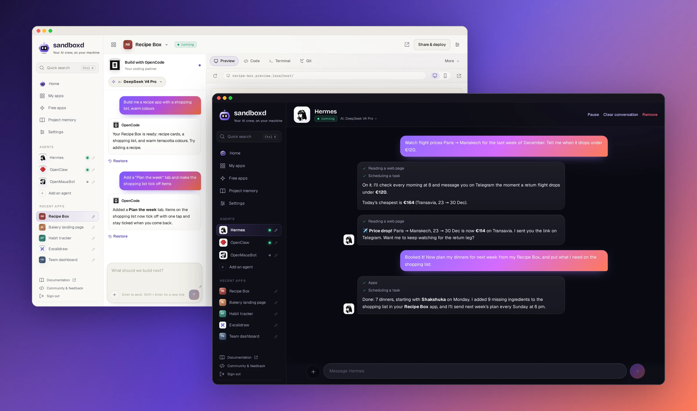
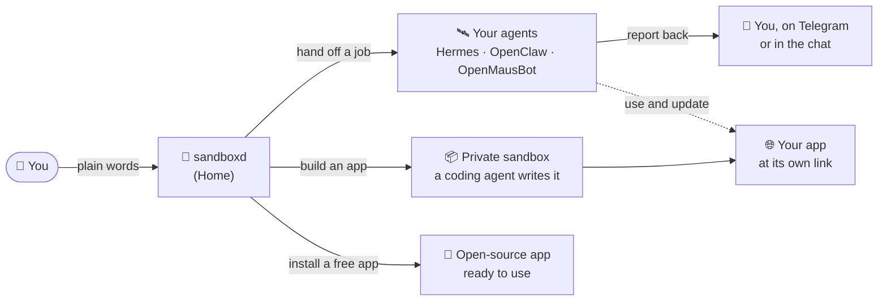
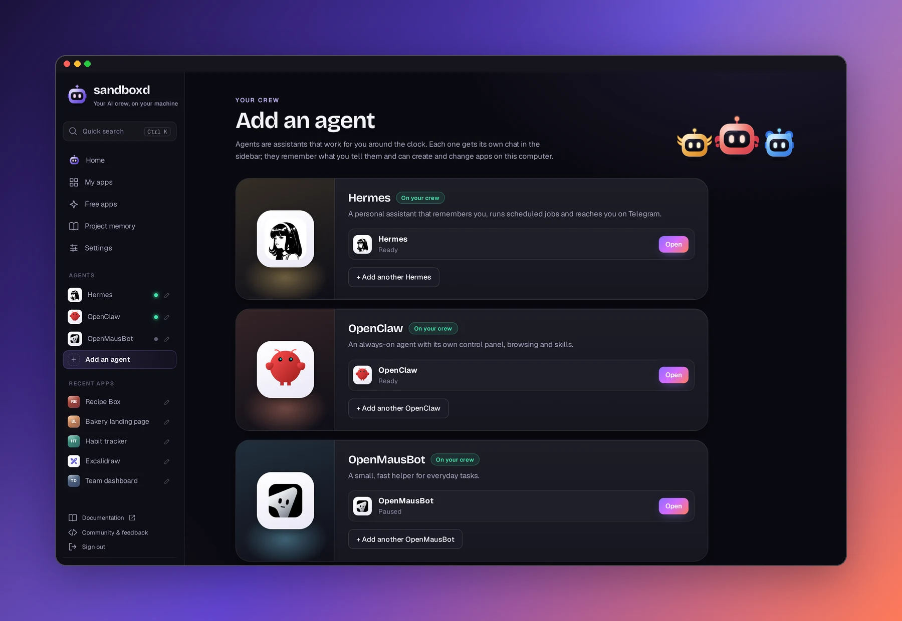
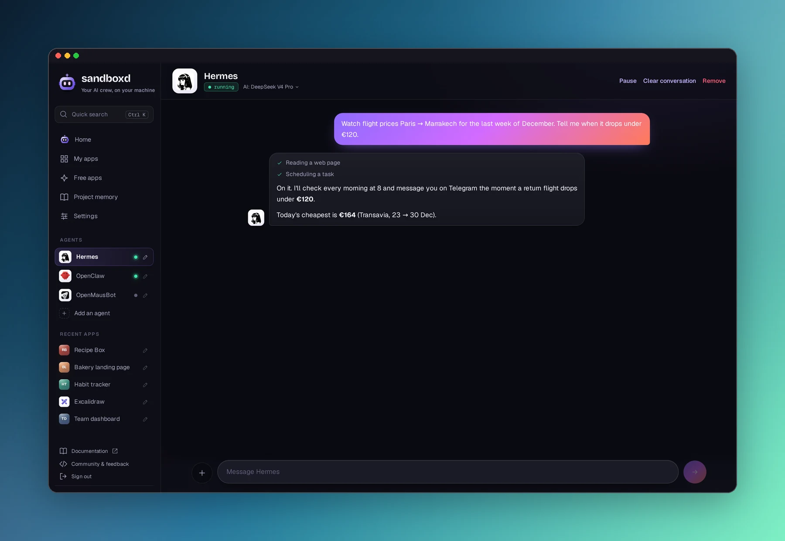
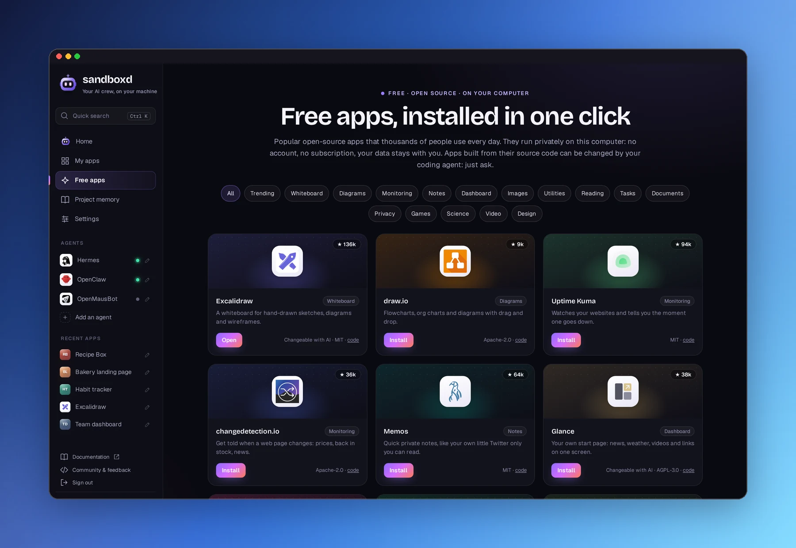

<h1 align="center">sandboxd</h1>

<p align="center">
  <b>Your own AI agents, working for you around the clock, on your computer.</b><br/>
  They take on jobs, keep at them, report back, and build the apps you need along the way.<br/>
  Free to start · No code · Runs on your machine · Open source (MIT)
</p>

<h3 align="center">🔥 Trend of the Day on Trendshift</h3>

<p align="center">
  <a href="https://trendshift.io/repositories/45741?utm_source=trendshift-badge&utm_medium=badge&utm_campaign=badge-trendshift-45741" target="_blank" rel="noopener noreferrer">
    
  </a>
</p>

<p align="center">
  <a href="https://sandboxd.io/demo/"></a>
  &nbsp;
  <a href="https://sandboxd.io/quickstart"></a>
  &nbsp;
  <a href="https://github.com/tastyeffectco/sandboxd/stargazers"></a>
</p>

<p align="center">
  <a href="https://sandboxd.io"></a>
  <a href="LICENSE"></a>
  
  <a href="https://github.com/tastyeffectco/sandboxd/releases"></a>
  <a href="https://github.com/sponsors/tastyeffectco"></a>
</p>


<p align="center">
  
</p>

---

## What is sandboxd?

**An AI crew that works for you: agents first, apps on demand.**

Chatbots answer and forget. sandboxd's agents **keep working**: they remember
you, run jobs on a schedule, browse the web, message you on Telegram, and use
(or build) apps to get things done. You talk to them in plain words.

| You say… | Your crew… |
|---|---|
| *"Watch flight prices to Marrakech and tell me when it drops under €120"* | an agent checks every morning and messages you the moment it does |
| *"Plan my dinners every week from my recipes"* | an agent makes the plan every Sunday and sends it to you |
| *"Build me a recipe app with a shopping list"* | a coding agent builds a real, working app in minutes, with its own link |
| *"Install Excalidraw for me"* | sets up a popular free app in one click |

Everything runs on **your** computer or server: your apps, your code and your
data live there, and no subscription is needed. It starts free with a built-in
AI, and you can plug in ChatGPT, Claude, any other AI, or a model running on
your own computer whenever you like.

## How it works



1. **Ask on Home.** One chat with the sandboxd agent, your crew's lead. It
   hands each job to the right agent, or starts building.
2. **Your agents get to work, and keep at it.** Each runs in its own locked-down
   container with its own memory, on a schedule or whenever you ask, and tells you
   what it found.
3. **Apps when you need them.** A coding agent builds each app in a private
   sandbox while you watch the live preview. Chat to change anything; every step
   is saved, so you can go back.

<p align="center">
  
</p>

## A quick tour

<table>
  <tr>
    <td width="50%" valign="top"><br><b>Home</b><br><sub>One chat with your crew's lead: hand off a job, ask for an app, or ask what your agents did today.</sub></td>
    <td width="50%" valign="top"><br><b>Your agents</b><br><sub>Hermes, OpenClaw and OpenMausBot, or several of each, each with its own memory.</sub></td>
  </tr>
  <tr>
    <td width="50%" valign="top"><br><b>Agents that keep working</b><br><sub>Hermes watches flight prices every morning, then plans dinners and fills the shopping list in your Recipe Box app.</sub></td>
    <td width="50%" valign="top"><br><b>My apps</b><br><sub>Every app your crew built, plus what's trending on GitHub.</sub></td>
  </tr>
  <tr>
    <td width="50%" valign="top"><br><b>Free apps</b><br><sub>Excalidraw, draw.io, Uptime Kuma and many more, installed in one click.</sub></td>
    <td width="50%" valign="top"><br><b>Choose your AI</b><br><sub>Free to start. Add ChatGPT, Claude, OpenRouter, CometAPI or a model on your own computer.</sub></td>
  </tr>
</table>

<p align="center">
  <b>▶ <a href="https://sandboxd.io/demo/">Try the live demo</a></b> · click around with sample data, nothing to install<br/>
  <sub>Light or dark: <b>Settings → Appearance</b> follows your computer, or pick one.</sub>
</p>

## What your crew can do

- **🤖 Agents that work around the clock.** Open-source assistants
  ([Hermes](https://github.com/NousResearch/hermes-agent), OpenClaw,
  OpenMausBot) that remember you, run scheduled jobs, browse the web, reach you
  on Telegram, and create or change apps to get the job done. Add several of
  each. Only agents that run fully on your machine, each in its own locked-down
  container with no keys inside. [Agents →](docs/operator-agents.md)
- **💬 One lead for the whole crew.** The sandboxd agent hands jobs to your
  agents, brings the answers back, and never deletes anything without your yes.
  [The sandboxd agent →](docs/sandboxd-agent.md)
- **✨ Apps built on demand.** A habit tracker, a landing page for your bakery, a
  team dashboard. A coding agent builds it in minutes; attach your logo or photos
  and it uses them.
- **🧩 Free apps in one click.** Popular open-source apps (whiteboards,
  diagrams, notes, PDF tools, a CAD modeler, a physics simulator…), each tested
  and ready. [Free apps →](docs/free-apps.md)
- **🧠 Pick your AI.** Free by default. In **Settings → AI**, connect your
  ChatGPT or Claude subscription, OpenRouter, CometAPI, or a model on your own
  computer (Ollama, LM Studio). [Model connections →](docs/model-providers.md)
- **🚀 Keep what you build.** The code is yours: push it to your own Git
  repository or run it on your own server.

## Get started

**🖥️ Windows or macOS: the desktop app.** Click **Install & start** and it sets
everything up by itself: no Docker, no terminal, no account.
[Download and setup →](docs/desktop.md)

**🐧 Linux, a server, or your own machine: one command.** Needs Docker (with the
Compose plugin) and git.

```bash
curl -fsSL https://raw.githubusercontent.com/tastyeffectco/sandboxd/main/install.sh | bash
```

It prints your link: open it, create a password, and tell sandboxd what you want
on **Home**: hand off a job or ask for an app. Works on Intel/AMD and ARM, including Apple Silicon.

**☁️ No computer to spare?** [Deploy to a VPS in one click](#-deploy-to-a-vps-in-one-click)
or let us [run it for you](#managed--we-run-it-for-you).

## For developers

sandboxd is also an **engine you can build on**. Everything the console does is a
`/v1` HTTP call, so you can run many sandboxes for your own users: an AI
app-builder, an agent platform, a coding playground, or per-user preview
environments.

```bash
API=http://127.0.0.1:9090
curl -s -XPOST $API/v1/agents/claude-code/api-key -d '{"api_key":"sk-ant-..."}'
ID=$(curl -s -XPOST $API/sandbox -d '{"ports":[3000]}' | sed -E 's/.*"id":"([^"]+)".*/\1/')
curl -s -XPOST $API/v1/sandboxes/$ID/tasks -d '{"prompt":"build a todo app on port 3000","agent":"opencode"}'
# open the result at  http://s-$ID-3000.preview.localhost
```

**Under the hood**

- **One Go program driving Docker,** with Traefik for links and SQLite for state:
  no Kubernetes, no separate database, no queue.
- **Isolated sandboxes:** a hardened container per app, with its own files,
  limits and live preview link. Idle apps sleep and wake on demand, so one
  ordinary machine holds many.
- **Coding agents:** OpenCode, Claude Code, Codex and Pi. **No credential ever
  enters a sandbox** (a proxy adds it on the wire), and every task is
  checkpointed and revertible.
- **Bring any model:** OpenAI- and Anthropic-compatible endpoints, local servers
  and LiteLLM gateways (including AWS Bedrock). Keys stay encrypted on the
  control plane.
- **Runtime presets:** React/Vite, Next.js, Node/Express, FastAPI, Worker.
  [Base image, stacks &amp; presets →](https://sandboxd.io/guides/images-stacks-presets)
- **Files, Git and secrets:** in-browser editor and diffs, commit and push,
  encrypted write-only secrets per app. Snapshots, fork and restore, activity
  timeline, per-process logs. [Architecture →](https://sandboxd.io/reference/architecture)

<details>
<summary><b>Install options</b> (verified images, build from source, headless, upgrades)</summary>

- **Console:** `http://console.localhost`. Run **`./console-login.sh`** to show
  the URL or reset the password.
- **API:** `http://127.0.0.1:9090` (`curl http://127.0.0.1:9090/healthz` → `ok`)
- **Verified images:** on a clean stable release checkout with `cosign`
  installed, the installer pulls the prebuilt multi-arch images and verifies each
  one is **cosign-signed with build provenance** by
  [the release workflow](.github/workflows/release-images.yml) at the exact
  release tag. `./install.sh --pull` requires those checks; a failure in
  automatic mode falls back to building from source.
- **Build from source:** **`./install.sh --build`** compiles every image locally,
  so you audit exactly what runs. A first-class, fully supported path.
- **Desktop app from the CLI:** installed by default on macOS; opt out with
  `--no-desktop` / `-NoDesktop` or `SANDBOXD_DESKTOP=0`. `install.ps1` remains for
  existing Docker Desktop/WSL setups on Windows.
- **Headless:** `--no-console --no-desktop` (Windows: `-NoConsole -NoDesktop`).
- **Upgrade later:** **`./upgrade.sh`** backs up your database, health-checks the
  new version and rolls back automatically if it fails
  ([Upgrading](docs/upgrading.md)). `./upgrade.sh --check` shows your version.

</details>

**Full walkthrough → [sandboxd.io/quickstart](https://sandboxd.io/quickstart)** ·
**[Console guide](console/README.md)** · **[`AGENTS.md`](AGENTS.md)** for driving
it from your own agent. Just need one or two containers, with no AI? A shell
script or `docker run` is simpler ([why not just a script?](https://sandboxd.io/what-is-sandboxd)).

## 🚀 Deploy to a VPS in one click

sandboxd needs one Linux server with Docker — nothing else. Grab a server
below (2 vCPU / 4 GB is plenty to start), paste our
[cloud-init file](deploy/cloud-init.yaml) at creation, and it installs itself.

> **Disclosure:** we earn a referral commission when you sign up through the
> provider links below, at no additional cost to you. It helps fund sandboxd's
> development.

[](https://www.vultr.com/?ref=9912150)

<!-- ENABLE THESE AS EACH AFFILIATE LINK ARRIVES (uncomment + replace placeholder):
[](YOUR_DO_AWIN_LINK)
[](YOUR_KAMATERA_AFF_LINK)
[](YOUR_HOSTINGER_AFF_LINK)
Linode removed — cash affiliate program discontinued (credits only as of Jul 2026).
-->

Then on the new server (or paste [`deploy/cloud-init.yaml`](deploy/cloud-init.yaml) as user-data and skip this):

```bash
curl -fsSL https://raw.githubusercontent.com/tastyeffectco/sandboxd/main/deploy/bootstrap.sh | sudo bash
```

Full per-provider walkthrough: [deploy/DEPLOY.md](deploy/DEPLOY.md).

## Get a public URL — sandboxd Cloud

Out of the box, previews live on `<ip>.sslip.io` or `localhost`: fine on your
network, useless for sharing. **[sandboxd Cloud](https://sandboxd.io/cloud)**
gives the server you already run `https://you.sandboxd.io` (console, API and
`*.preview.you.sandboxd.io`) in one command — no domain, DNS, open ports or
certificates, and it works behind NAT, on a laptop, or on a $5 VPS. Your
compute and data stay on your machine. $9.99/server/month, 50% off at launch.
Prefer your own domain? [Production / TLS](https://sandboxd.io/guides/production-tls).

## Managed — we run it for you

Don't want to run the server yourself? We'll **install, configure, and manage
sandboxd on your own box** — BYOC (your compute, your data, no lock-in). One-time
setup + optional monthly management. **[See Managed →](https://sandboxd.io/managed)**

---

<h3 align="center">📣 Stay in the loop</h3>

<p align="center">
  Self-hosting is <b>MIT and free, forever</b> — <code>git clone</code> and you're done.<br/>
  Want the <b>1.0 release + occasional product updates</b>, or a <b>managed cloud</b> so you don't run the box yourself? Two links:
</p>

<p align="center">
  <a href="https://sandboxd.io/?news=1"></a>
  &nbsp;
  <a href="https://sandboxd.io/?waitlist=cloud"></a>
</p>

<p align="center"><sub>No spam, one-click unsubscribe, and the cloud is <b>optional</b> — the self-hosted engine is always the full product.</sub></p>

---

## Documentation

Full docs live at **[sandboxd.io](https://sandboxd.io)**:

| Getting started | Guides | Reference |
|---|---|---|
| [What is sandboxd?](https://sandboxd.io/what-is-sandboxd) | [The web console](https://sandboxd.io/guides/console) · [Get an app running](https://sandboxd.io/guides/apps-in-the-console) | [API (OpenAPI)](https://sandboxd.io/reference/api) |
| [Quickstart](https://sandboxd.io/quickstart) | [Coding agents](https://sandboxd.io/guides/agents) | [Configuration](https://sandboxd.io/reference/configuration) |
| [Core concepts](https://sandboxd.io/concepts) | [Base image, stacks &amp; presets](https://sandboxd.io/guides/images-stacks-presets) | [Architecture](https://sandboxd.io/reference/architecture) |
| [Roadmap](https://sandboxd.io/roadmap) | [Presets &amp; `sandbox.yaml`](https://sandboxd.io/guides/images-stacks-presets) · [Auto-detection &amp; App Store](https://sandboxd.io/guides/runtime-and-store) · [Undo a task](https://sandboxd.io/guides/tasks) · [Production / TLS](https://sandboxd.io/guides/production-tls) · [Hardening](https://sandboxd.io/guides/hardening) · [Uninstall](https://sandboxd.io/guides/uninstall) | [`AGENTS.md`](AGENTS.md) · [`ARCHITECTURE.md`](ARCHITECTURE.md) |

In this repository: [desktop](docs/desktop.md) · [free apps](docs/free-apps.md) ·
[agents](docs/operator-agents.md) · [the sandboxd agent](docs/sandboxd-agent.md) ·
[model connections](docs/model-providers.md) · [agent auth](docs/agent-auth.md).

Building on it from your own agent? **[`AGENTS.md`](AGENTS.md)** is a
copy-pasteable runbook.

## Roadmap &amp; community

- 🗺️ **Roadmap** — [what's shipped &amp; next](https://sandboxd.io/roadmap) · [public project board](https://github.com/users/tastyeffectco/projects/3)
- 💬 **Discussions** — [ask &amp; get self-hosting help](https://github.com/tastyeffectco/sandboxd/discussions)
- 🤝 **Contribute** — good first PRs: add a framework recipe (one YAML file in [`control-plane/internal/recipes/data`](control-plane/internal/recipes/data)) or a runtime preset ([`CONTRIBUTING.md`](CONTRIBUTING.md))
- 🔒 **Security** — report privately per [`SECURITY.md`](SECURITY.md)

> **Beta · 0.x.** Container isolation (not VMs), single-server, and API auth off
> by default — all fine for your own users; tighten before untrusted
> multi-tenancy. See [Hardening](https://sandboxd.io/guides/hardening). Expect the
> occasional breaking change before 1.0 — pin a version and update as you go.

## ⭐ If sandboxd is useful, star it

Stars are how other builders find sandboxd — it's the fastest way to support the
project (and it keeps us going). Thank you 🙏

[](https://star-history.dera.page/#tastyeffectco/sandboxd&type=Date)

## License

[MIT](LICENSE). Use it, ship it, sell what you build on it.

## Sponsors

sandboxd is free and MIT-licensed. **Sponsors keep it maintained and fund the
[deploy roadmap](https://github.com/sponsors/tastyeffectco)** — thank you to
everyone who chips in.

<!--
  SPONSOR LOGO WALL — how to add a sponsor:
  Drop a cell into the <p align="center"> grid below (highest tiers first):
      <a href="https://SPONSOR_SITE"></a>
  Guidelines: logo ~130px wide, PNG or SVG, hosted on a stable URL. Remove the
  placeholder <em> line once the first real logo lands.
-->
<p align="center">
  <!-- sponsor logos go here -->
  <em>No sponsors yet — <a href="https://github.com/sponsors/tastyeffectco">be the first</a>.</em>
</p>
