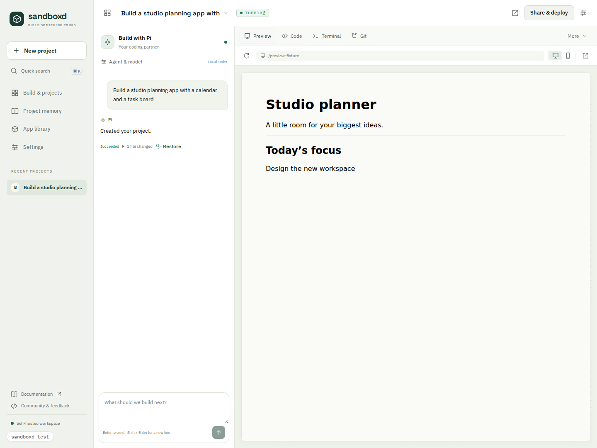

# sandboxd console

Your AI crew, self-hosted, over sandboxd's public `/v1` API: it builds apps and
runs agents for you. Tell the sandboxd agent on Home what you want (an app, a
free open-source app or an agent such as Hermes), then keep shaping each app
beside a live preview or chat with your agents.
The console is a Vite + React SPA; it accesses neither the database nor
workspace files except through the API.



Screenshots use the browser suite's sample API responses and preview fixture.
The [mobile settings view](../docs/images/console-settings-mobile.png) shows the
same console at a 390px viewport.

## Run it

From the repository root:

```bash
docker compose --profile console up -d
```

Open <http://console.localhost>, or `console.<PREVIEW_DOMAIN>:<HTTP_PORT>`.
Traefik routes the console and app previews; nginx serves the SPA and proxies
same-origin `/v1` requests to sandboxd. Authentication is enabled by default.
The first visit creates the console password. Core mode without the `console`
profile runs sandboxd without this UI.

## Build an app

1. **Home** is one chat with your sandboxd agent. Say what you want in plain
   words: "a habit tracker", "install JSON Crack from GitHub", "add a
   Researcher agent". It builds the app, installs the free app or adds the
   agent, and its replies are signed **sandboxd**. If the engine is too old to
   have a sandboxd agent, Home opens **My apps** instead.
2. **My apps** lists every app to open again, with search and the **Trending on
   GitHub** free apps. The sidebar shows your agents and **Recent apps**. To
   rename an app or an agent or change its icon, click the small pencil next to
   it in the sidebar, or right-click it.
3. Each app has its own chat beside **Preview**, **Code**, **Terminal**, or
   **Git**. Task progress streams live and reconnects through durable task
   history. Stop an active task, inspect changed files, or restore an available
   task checkpoint with **Restore** (not offered in the sandboxd agent's chat
   on Home). A task that ends early is marked **Didn't
   finish** or **Stopped**; finished tasks have no badge.
4. Opening a sleeping app wakes it ("Waking your app…"). The header shows
   **Wake up** for a stopped app and **Set up app** when it has no workspace yet.

### Choose the AI

Above every message box, the **AI** button (for example **AI · Free AI**) lists
your AIs in plain words: **Free AI** (OpenCode's built-in free tier, no
account), each model of your connections ("DeepSeek V4 Pro · OpenRouter"),
**ChatGPT (Codex)**, **Claude**, and OpenCode or Pi accounts. **Connect another
AI** opens Settings → AI. **More options** shows the detailed agent, connection
and model pickers. New chats start on the AI chosen in **Settings → AI**. A
Claude Pro or Max subscription signs in once in each project when the chat asks
("Sign in with Claude").

### Attach files

Click **+** next to the message box, drop files on the chat, or paste (for
example a screenshot), on Home and in every app chat. Up to 10 files at a time,
25 MB each. They are saved in the project's hidden `.attachments/` folder
(`PUT /v1/sandboxes/{id}/files`), and the message tells the agent where they
are. The built-in Free AI cannot look at images; it may read them slowly with
code, so pick another AI for picture-heavy work. Agent rooms (Hermes, OpenClaw,
OpenMausBot) have their own attachments.

The project menu contains workspace controls, rename and deletion. **More** opens
secrets, versions, project memory, runtime and activity. On small screens, switch
between **Chat** and **Workspace**. `Ctrl+K` / `Cmd+K` searches apps and settings.
App tabs and settings sections support hash URLs.

Message drafts survive navigation to Settings in the current page session. They
are cleared on sign-out and are not persisted across a page reload. Code and
memory edits survive tab switches, with a discard warning before leaving the
project or browser page.

## Connections and settings

**AI** comes first:

- **New chats use:** the AI every new chat starts with. It is saved on the
  engine as the instance setting `agents.default_ai` (`{agent, provider,
  model}`; an empty agent means the built-in Free AI) through
  `GET`/`PATCH /v1/settings`. You can still switch for one chat with the AI
  button.
- **Add an AI:** connect **OpenRouter** (one-click sign-in in the desktop app;
  in a browser, add an OpenRouter key under Model connections); paste a **CometAPI** key (the
  account link is a referral, with an affiliate disclosure always shown; the
  key is checked with CometAPI before it is saved, and the connection offers
  `auto`, `deepseek-v4-pro`, `claude-sonnet-4-6` and `qwen3-coder-plus`, starting
  on `auto`); use a **ChatGPT subscription** through Codex; choose **Claude** for
  a Pro or Max subscription (sign in once per project); or **Something else**
  for any other model connection.

The **Advanced** group holds the detailed pages:

- **Model connections:** compatible OpenAI Chat Completions or Anthropic Messages
  endpoints, gateway keys, exact model aliases and token limits. See
  [model providers](../docs/model-providers.md) for LiteLLM and local servers.
- **Coding agents:** connect an API key or an imported Codex/OpenCode/Pi login,
  disconnect accounts and choose built-in default models. A Claude subscription
  signs in inside each project ("Sign in with Claude" in the chat).
- **Git credentials:** add named host credentials for private imports and pushes.
- **Security & API keys:** change the console password, sign out sessions, create
  scoped API keys and revoke them. New API keys are shown only once.
- **Sleep & wake:** configure when idle apps go to sleep and keepalive limits,
  when the operator allows edits.
- **Instance:** runtime/network configuration and the agent system prompt,
  including settings managed through environment variables.

Credentials are submitted to the control plane. The console does not save them
in browser storage. Agent and model credentials stay behind the existing
control-plane proxy; see [agent authentication](../docs/agent-auth.md).

## Workspace tools

**Secrets & variables** supports creation, policy changes, explicit secret
rotation and deletion. Sensitive values are write-only; changing only the access
policy does not erase the saved secret. Config values are stored by the API;
they are **not automatically injected into the runtime environment**. Access
policies record the intended broker policy.

**Versions** captures workspace snapshots, restores an earlier version, or opens
an independent copy. Snapshots include code, packages, build output and workspace
data. Stop the workspace first for a consistent capture. Restoring replaces the
current sandbox and workspace and requires explicit confirmation.

**Project memory** edits `BRAIN.md` and focused notes under `brain/`. **Runtime**
exposes detected presets, processes and logs. **Activity** shows durable app
events.

**Share & deploy** provides the current preview link and deployment guidance.
Sharing depends on the configured network and preview access; the console does
not provision a public production deployment.

## Develop and verify

```bash
pnpm install --frozen-lockfile
pnpm dev                      # http://127.0.0.1:8787
pnpm exec tsc --noEmit
pnpm test
pnpm build
pnpm exec playwright install chromium
pnpm exec playwright test --config playwright.providers.config.ts
```

The development server proxies `/v1` to `$SANDBOXD_URL` (default
`http://127.0.0.1:9090`). The provider/builder browser suite starts its own Vite
server on port 18787 and uses stateful API fixtures. It verifies console requests,
error recovery, dialogs, draft retention and responsive layouts without running
Docker, paid models or production services. Go/runtime tests cover backend
boundaries separately. The opt-in `pnpm test:e2e` suite requires a disposable running
stack at `CONSOLE_URL`, and `CONSOLE_PASSWORD` when authentication is enabled. It
creates workspaces and runs an agent, then removes its own test apps. Do not point
that suite at a production installation.

`VITE_DEMO=1 pnpm dev` runs the sample-data console. Demo previews and screenshots
are illustrative; they do not demonstrate a deployed application.
