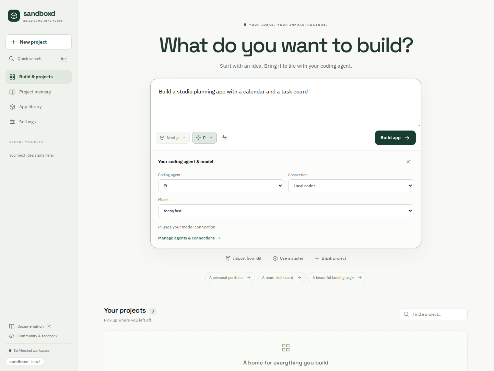
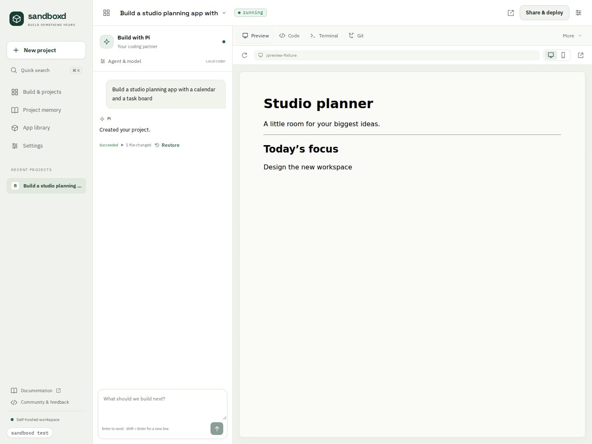

# sandboxd console

A self-hosted app builder over sandboxd's public `/v1` API. Start with a prompt,
choose a stack and coding agent, then build alongside a live preview. The console
is a Vite + React SPA; it accesses neither the database nor workspace files
except through the API.





Screenshots use the browser suite's sample API responses and preview fixture.
The [mobile settings view](../docs/images/console-settings-mobile.png) shows the
same console at a 390px viewport.

## Run it

From the repository root:

```bash
docker compose --profile console up -d
```

Open <http://console.localhost>, or `console.<PREVIEW_DOMAIN>:<HTTP_PORT>`.
Traefik routes the console and app previews; nginx serves the SPA and proxies
same-origin `/v1` requests to sandboxd. Authentication is enabled by default.
The first visit creates the console password. Core mode without the `console`
profile runs sandboxd without this UI.

## Build an app

1. Describe the app on **Build & projects**. Choose a runtime preset, or keep
   **Automatic** to use the default starter. You can also import a Git repository,
   choose a template, or create an empty project.
2. Choose **OpenCode**, **Pi**, or **Claude Code**, then a connection and model.
   OpenCode offers its built-in free tier. Pi needs a model connection; Claude
   Code needs a connected account. The selected stack and model are sent to the
   API, not appended as suggestions to the prompt.
3. Select **Build app**. The console creates the app and workspace, waits for
   readiness, then submits the initial prompt once. If workspace creation fails,
   retry from the existing project; the original prompt is retained.
4. Continue the conversation beside **Preview**, **Code**, **Terminal**, or **Git**.
   Task progress streams live and reconnects through durable task history. Stop
   an active task, inspect changed files, or restore an available task checkpoint.

The project menu contains workspace controls, rename and deletion. **More** opens
secrets, versions, project memory, runtime and activity. On small screens, switch
between **Chat** and **Workspace**. `Ctrl+K` / `Cmd+K` searches projects and settings.
Project tabs and settings categories support hash URLs.

Prompt drafts survive navigation to Settings in the current page session. They
are cleared on sign-out and are not persisted across a page reload. Code and
memory edits survive tab switches, with a discard warning before leaving the
project or browser page.

## Connections and settings

- **Model connections:** compatible OpenAI Chat Completions or Anthropic Messages
  endpoints, gateway keys, exact model aliases and token limits. See
  [model providers](../docs/model-providers.md) for LiteLLM and local servers.
- **Coding agents:** connect an API key or subscription, use the guided Claude
  OAuth flow, disconnect accounts and choose built-in default models.
- **Git credentials:** add named host credentials for private imports and pushes.
- **Security & API keys:** change the console password, sign out sessions, create
  scoped API keys and revoke them. New API keys are shown only once.
- **Lifecycle:** configure idle stopping and keepalive limits when the operator
  allows edits. **Instance** shows runtime/network configuration and the agent
  system prompt, including settings managed through environment variables.

Credentials are submitted to the control plane. The console does not save them
in browser storage. Agent and model credentials stay behind the existing
control-plane proxy; see [agent authentication](../docs/agent-auth.md).

## Workspace tools

**Secrets & variables** supports creation, policy changes, explicit secret
rotation and deletion. Sensitive values are write-only; changing only the access
policy does not erase the saved secret. Config values are stored by the API;
they are **not automatically injected into the runtime environment**. Access
policies record the intended broker policy.

**Versions** captures workspace snapshots, restores an earlier version, or opens
an independent copy. Snapshots include code, packages, build output and workspace
data. Stop the workspace first for a consistent capture. Restoring replaces the
current sandbox and workspace and requires explicit confirmation.

**Project memory** edits `BRAIN.md` and focused notes under `brain/`. **Runtime**
exposes detected presets, processes and logs. **Activity** shows durable app
events. **App library** retains the existing one-click application installers.

**Share & deploy** provides the current preview link and deployment guidance.
Sharing depends on the configured network and preview access; the console does
not provision a public production deployment.

## Develop and verify

```bash
pnpm install --frozen-lockfile
pnpm dev                      # http://127.0.0.1:8787
pnpm exec tsc --noEmit
pnpm test
pnpm build
pnpm exec playwright install chromium
pnpm exec playwright test --config playwright.providers.config.ts
```

The development server proxies `/v1` to `$SANDBOXD_URL` (default
`http://127.0.0.1:9090`). The provider/builder browser suite starts its own Vite
server on port 18787 and uses stateful API fixtures. It verifies console requests,
error recovery, dialogs, draft retention and responsive layouts without running
Docker, paid models or production services. Go/runtime tests cover backend
boundaries separately. The opt-in `pnpm test:e2e` suite requires a disposable running
stack at `CONSOLE_URL`, and `CONSOLE_PASSWORD` when authentication is enabled. It
creates workspaces and runs an agent, then removes its own test apps. Do not point
that suite at a production installation.

`VITE_DEMO=1 pnpm dev` runs the sample-data console. Demo previews and screenshots
are illustrative; they do not demonstrate a deployed application.
